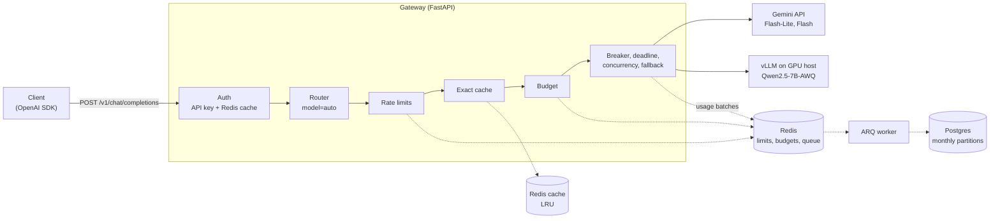
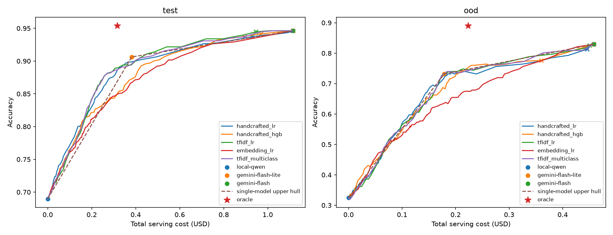

# LLM Gateway

English | [中文](README.zh.md)

A multi-tenant, OpenAI-compatible LLM gateway with a learned cost-quality router. It sits between applications and three models (a self-hosted Qwen2.5-7B on vLLM, Gemini Flash-Lite, and Gemini Flash), and handles authentication, rate limits, budgets, caching, failover, and usage accounting. With `model: "auto"`, a lightweight classifier picks the cheapest model likely to answer correctly before any model is called.

## Highlights

- **Learned routing**: on held-out questions, the `balanced` level cuts cost by **45%** and mean latency by **36%** versus always using Gemini Flash while retaining **98.7%** of its accuracy; the `economy` level cuts cost by **88%** and serves **45%** of traffic on the self-hosted model.
- **Low overhead**: at 200 requests/s the gateway adds **2.5 ms** median and **4.6 ms** p95 (authentication, rate limiting, budget, and cache checks included).
- **No lost usage records under overload**: across a 100 to 1,600 requests/s ramp (125K requests), the usage table recorded 125,222 rows for 125,207 successful requests, with the queue fully drained; router-label spend reconciled with the usage table to eight decimal places.
- **Stable under long upstream calls**: 400 concurrent in-flight requests with 2-second upstream latency completed 24,000 of 24,000, with p95 within 6 ms of the upstream time.
- **Decisions backed by measurements**: thresholds selected on training data only, a semantic cache rejected after a false-hit benchmark, an index chosen by `EXPLAIN` measurements, and drift detection that flags unfamiliar traffic.

## Architecture



A request is authenticated, routed (for `model: "auto"`), checked against rate limits, the exact-response cache, and the tenant's monthly budget, then sent to a provider behind a per-provider circuit breaker, a request deadline, and (for the local model) a concurrency limit. If the chosen model fails before the first byte is sent, the request falls back to the next model. Usage is recorded off the request path and written to Postgres by a separate worker.

| Design decision | Why | Evidence |
|---|---|---|
| API keys stored as SHA-256 hashes, with a Redis authorization cache and tombstones on revocation | Fast lookups without trusting a stale cache after revocation | Auth stage 0.8 ms median at 200 requests/s ([load tests](scripts/loadtest/README.md)) |
| Rate limits and budgets as atomic Redis Lua scripts | No race between check and update across concurrent requests | Rate-limit stage 0.8 ms median |
| Usage accounting through an in-memory buffer, one Lua call per batch with an idempotent receipt, an ARQ queue, and monthly Postgres partitions | Keeps database writes off the request path without losing or double-counting records | No lost records across a 125K-request overload ramp |
| `(tenant_id, created_at)` index instead of a covering index | Half the index size on the most write-heavy table | 21.6 ms worst-tenant 30-day report ([benchmark](docs/benchmarks/usage-report-index.md)) |
| Retry and fallback only before the first streamed byte | Clients never receive two spliced answers | Enforced by the streaming commit point |
| Per-provider circuit breakers and a total request deadline | Fail fast and fail over when a provider is down | 24,000 of 24,000 requests at 400 in flight |
| Local model limited to 16 concurrent requests | Largest tested value before long-prompt throughput collapses | [vLLM sweep](docs/benchmarks/serving/throughput/) |
| Exact cache only, opt-in; no semantic cache | Embedding similarity confuses changed numbers, names, and roles | No threshold below 1% false hits on hard negatives ([benchmark](docs/benchmarks/semantic-cache.md)) |
| Router exported as JSON and scored in pure Python | No scikit-learn in the gateway; safe loading | Matches scikit-learn to 2.2e-16 |

## Learned Routing

With `model: "auto"`, two logistic-regression classifiers over TF-IDF features estimate whether the local model and Flash-Lite will answer correctly. The request goes to the first model whose probability clears the threshold for the requested quality level; Gemini Flash is the fallback.

```text
request text -> TF-IDF -> P(local correct), P(lite correct)   (in process, milliseconds)
             -> first model with P >= tau(level), else Gemini Flash
```

Results on 651 held-out questions (GSM8K and MMLU-Pro), compared with always using Gemini Flash at list prices:

| Level | Accuracy retained | Cost reduction | Latency reduction | Traffic on local model |
|---|---:|---:|---:|---:|
| high | 99.8% | 19% | 17% | 0.5% |
| **balanced** | **98.7%** | **45%** | **36%** | 3% |
| **economy** | **92.9%** | **88%** | **47%** | **45%** |



- Labels were collected through the gateway itself: 3 models x 3,319 questions.
- Thresholds were selected on training data only, with nested cross-validation; the test set was evaluated once.
- On subjects never seen in training, the router escalates to the strongest model without losing accuracy, and drift detection (PSI on vocabulary coverage and predicted probabilities) flags that traffic.

Full experiment report: [English](docs/router-report.md) | [中文](docs/router-report.zh.md)

## Quick Start

Requires Docker with Compose. Set `GEMINI_API_KEY` in `.env`. The self-hosted model is optional: without `VLLM_BASE_URL`, `model: "auto"` routes among the Gemini models only.

```sh
cp .env.example .env
docker compose up -d --wait

docker compose exec gateway python -m llm_gateway.cli create-tenant demo
docker compose exec gateway python -m llm_gateway.cli create-key --tenant demo --name quickstart

curl http://127.0.0.1:8000/v1/chat/completions \
  -H "Authorization: Bearer <key from create-key>" \
  -H "Content-Type: application/json" \
  -H "X-Gateway-Quality: balanced" \
  -d '{"model": "auto", "messages": [{"role": "user", "content": "How many days are in a leap year?"}]}'
```

The `X-Gateway-Model` response header shows which model answered.

## Documentation

- [Learned routing experiment report](docs/router-report.md) ([中文](docs/router-report.zh.md))
- [Configuration and API reference](docs/reference.md): setup, models, streaming, admin API, limits, budgets, caching, vLLM, drift monitoring
- Benchmarks: [load tests](scripts/loadtest/README.md), [usage report index](docs/benchmarks/usage-report-index.md), [semantic cache](docs/benchmarks/semantic-cache.md), [router data](docs/benchmarks/router/README.md)
