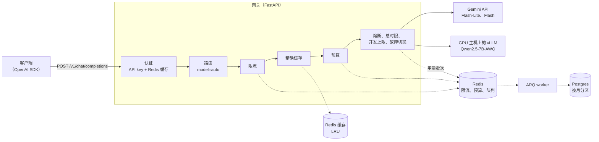
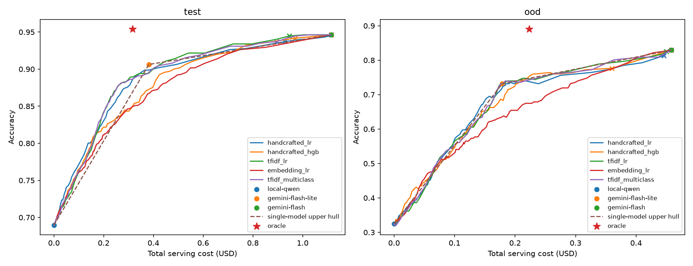

# LLM Gateway

[English](README.md) | 中文

一个多租户、兼容 OpenAI 接口的 LLM 网关，内置学习型的成本-质量路由器。它位于应用和三个模型（vLLM 上自托管的 Qwen2.5-7B、Gemini Flash-Lite、Gemini Flash）之间，负责认证、限流、预算、缓存、故障切换和用量记账。使用 `model: "auto"` 时，一个轻量分类器会在调用任何模型之前，选出最可能答对的最便宜模型。

## 亮点

- **学习型路由**：在未参与训练的题目上，与全部使用 Gemini Flash 相比，`balanced` 档成本降低 **45%**、平均延迟降低 **36%**，保留 **98.7%** 的准确率；`economy` 档成本降低 **88%**，**45%** 的流量由自托管模型处理。
- **开销低**：每秒 200 个请求时，网关增加的延迟中位数为 **2.5 ms**，p95 为 **4.6 ms**（包括认证、限流、预算和缓存检查）。
- **过载下不丢用量记录**：在每秒 100 到 1,600 个请求的递增压测中（共 12.5 万个请求），usage 表为 125,207 个成功请求记录了 125,222 行，队列全部处理完毕；路由器打标签的花费与 usage 表对账，精确到小数点后 8 位。
- **上游缓慢时依然稳定**：上游延迟 2 秒、同时在途 400 个请求时，24,000 个请求全部成功，p95 与上游耗时只差 6 ms 以内。
- **每个决策都有数据支撑**：阈值只在训练集上选定；语义缓存经误命中测试后被否决；索引方案根据 `EXPLAIN` 测量选定；漂移检测能识别不熟悉的流量。

## 架构



一个请求依次经过：认证；路由（`model: "auto"` 时）；限流、精确缓存和租户月度预算检查；然后发往模型，途中受每个模型的熔断器、请求总时限以及（本地模型的）并发上限保护。如果选中的模型在发出第一个字节之前失败，请求会切换到下一个模型。用量记录不在请求路径上完成，而是由独立的 worker 写入 Postgres。

| 设计决策 | 原因 | 依据 |
|---|---|---|
| API key 以 SHA-256 哈希存储，配合 Redis 授权缓存，撤销时写入删除标记 | 查找快，同时撤销后不会信任过期的缓存 | 每秒 200 个请求时，认证环节中位数 0.8 ms（[压测](scripts/loadtest/README.md)） |
| 限流和预算用原子执行的 Redis Lua 脚本实现 | 并发请求之间，检查和更新不会出现竞态 | 限流环节中位数 0.8 ms |
| 用量记账：内存缓冲，每批一次 Lua 调用并附带幂等回执，经 ARQ 队列写入按月分区的 Postgres | 数据库写入不在请求路径上，且不丢失、不重复计数 | 12.5 万请求的过载压测中没有丢失记录 |
| 使用 `(tenant_id, created_at)` 索引，而不是覆盖索引 | 在写入最频繁的表上，索引体积减半 | 最大租户 30 天报表 21.6 ms（[基准测试](docs/benchmarks/usage-report-index.md)） |
| 只在发出第一个字节之前重试或切换模型 | 客户端永远不会收到两个模型拼接起来的回答 | 由流式输出的提交点保证 |
| 每个模型一个熔断器，加上请求总时限 | 模型故障时快速失败并切换 | 在途 400 个请求时 24,000 个全部成功 |
| 本地模型最多同时处理 16 个请求 | 长 prompt 下吞吐不崩溃的最大测试值 | [vLLM 扫描测试](docs/benchmarks/serving/throughput/) |
| 只用精确缓存，需显式开启；不用语义缓存 | embedding 相似度分辨不出数字、人名和角色的变化 | 在困难负例上，没有任何阈值能把误命中率压到 1% 以下（[基准测试](docs/benchmarks/semantic-cache.md)） |
| 路由器导出为 JSON，在网关中用纯 Python 打分 | 网关不依赖 scikit-learn，加载安全 | 与 scikit-learn 的结果最大相差 2.2e-16 |

## 学习型路由

使用 `model: "auto"` 时，两个基于 TF-IDF 特征的逻辑回归分类器，分别估计本地模型和 Flash-Lite 能否答对。请求交给第一个概率超过当前质量档位阈值的模型；都不满足时交给 Gemini Flash。

```text
请求文本 -> TF-IDF -> P(local 答对)、P(lite 答对)          （网关进程内，毫秒级）
         -> 第一个 P ≥ τ(档位) 的模型，否则交给 Gemini Flash
```

在 651 道未参与训练的题目（GSM8K 和 MMLU-Pro）上，按原价与全部使用 Gemini Flash 比较：

| 档位 | 保留的准确率 | 成本降低 | 延迟降低 | 本地模型分担的流量 |
|---|---:|---:|---:|---:|
| high | 99.8% | 19% | 17% | 0.5% |
| **balanced** | **98.7%** | **45%** | **36%** | 3% |
| **economy** | **92.9%** | **88%** | **47%** | **45%** |



- 训练标签通过网关自身收集：3 个模型 × 3,319 题。
- 阈值只在训练集上通过嵌套交叉验证选定，测试集只评估一次。
- 遇到训练中从未出现的学科时，路由器会升级到最强的模型，准确率不下降；漂移检测（对词表覆盖率和预测概率计算 PSI）能识别出这类流量。

完整实验报告：[中文](docs/router-report.zh.md) | [English](docs/router-report.md)

## 快速开始

需要安装 Docker 和 Compose。在 `.env` 中设置 `GEMINI_API_KEY`。自托管模型是可选的：没有设置 `VLLM_BASE_URL` 时，`model: "auto"` 只在 Gemini 模型之间路由。

```sh
cp .env.example .env
docker compose up -d --wait

docker compose exec gateway python -m llm_gateway.cli create-tenant demo
docker compose exec gateway python -m llm_gateway.cli create-key --tenant demo --name quickstart

curl http://127.0.0.1:8000/v1/chat/completions \
  -H "Authorization: Bearer <create-key 输出的 key>" \
  -H "Content-Type: application/json" \
  -H "X-Gateway-Quality: balanced" \
  -d '{"model": "auto", "messages": [{"role": "user", "content": "How many days are in a leap year?"}]}'
```

响应头 `X-Gateway-Model` 显示实际作答的模型。

## 文档

- [学习型路由实验报告](docs/router-report.zh.md)（[English](docs/router-report.md)）
- [配置与 API 参考](docs/reference.md)（英文）：安装、模型、流式输出、管理 API、限流、预算、缓存、vLLM、漂移监控
- 基准测试（英文）：[压测](scripts/loadtest/README.md)、[usage 报表索引](docs/benchmarks/usage-report-index.md)、[语义缓存](docs/benchmarks/semantic-cache.md)、[路由数据](docs/benchmarks/router/README.md)
