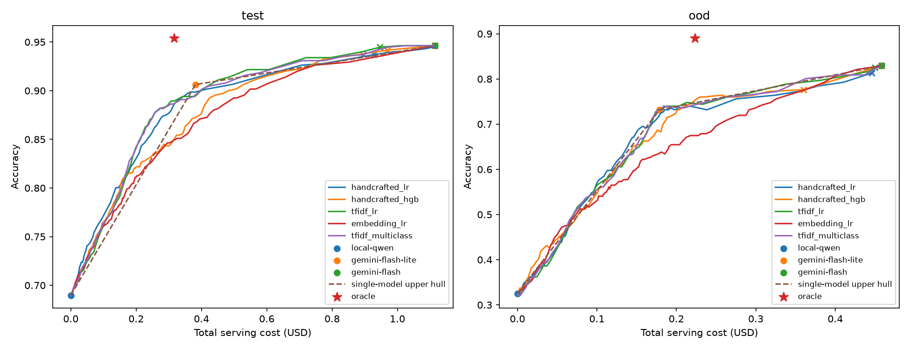

# Learned LLM Routing: Experiment Report

[中文版](router-report.zh.md)

## Abstract

This experiment implements and evaluates a three-tier learned cascade router inside an OpenAI-compatible, multi-tenant LLM gateway: a local Qwen2.5-7B-Instruct-AWQ (vLLM) -> Gemini 3.1 Flash-Lite -> Gemini 3.8 Flash. Before calling any model, the router predicts from the request text alone (TF-IDF + logistic regression) whether a cheaper model will answer correctly, and sends the request to the first model it is confident in. Thresholds are selected on the training set only, using nested cross-validation.

On 651 held-out questions, compared with always using Flash:

- **balanced**: cost reduced by **45%** and mean latency by **36%**, while retaining **98.7%** of the accuracy;
- **economy**: cost reduced by **88%**, with **45%** of traffic served by the local model; at matched cost, accuracy is **4.0** points higher than mixing models in fixed proportions.

On subjects never seen in training, the router automatically escalates requests to the strongest model, with no loss in quality. Building on this finding, the system adds drift detection that identifies such traffic (PSI 0.86-1.51, versus 0.003-0.031 for normal traffic).

All training labels were collected through the gateway itself (3 models x 3,319 questions).

---

## 1. Introduction and Research Questions

LLM prices differ by more than an order of magnitude. At list price, Gemini 3.8 Flash costs $7.50 per million output tokens, Flash-Lite $1.50, and a self-hosted model has zero marginal API cost. Yet most requests do not need the strongest model. If we can decide before the call that a cheaper model is good enough, cost drops sharply with almost no change in quality.

That decision must itself be cheap: calling an LLM to make the routing decision would consume the savings in both money and time. This experiment therefore considers only lightweight classifiers that run inside the gateway process in milliseconds.

The report answers four questions:

| | Research question |
|---|---|
| **RQ1** | Can a router that decides from the request text alone substantially cut cost and latency while preserving quality? |
| **RQ2** | Which text representation works best (handcrafted features / TF-IDF / embeddings)? Does the decision structure (cascade vs. multiclass) matter? |
| **RQ3** | How does the router behave on domains it never saw in training? |
| **RQ4** | Can we detect online that the router is handling unfamiliar traffic? |

---

## 2. Experimental Setup

### 2.1 Models and Prices

| Gateway model | Underlying model | Thinking | max_tokens | Price (input / output, USD per 1M tokens) |
|---|---|---|---:|---|
| `local-qwen` | Qwen/Qwen2.5-7B-Instruct-AWQ, vLLM v0.11.0, RTX 5070 Ti 16 GB | None | 1024 | 0 / 0 (marginal cost; excludes hardware and electricity) |
| `gemini-flash-lite` | gemini-3.1-flash-lite | Off (budget 0) | 1024 | 0.25 / 1.50 |
| `gemini-flash` | gemini-3.8-flash | LOW | 4096 | 1.50 / 7.50 |

### 2.2 Data and Splits

| Dataset | Questions | Type | Role |
|---|---:|---|---|
| GSM8K (test) | 1,319 | Math word problems with numeric answers | Represents "easy" requests that most models answer correctly |
| MMLU-Pro (test, stratified by subject) | 2,000 / 12,032 | 10-option multiple choice across 14 subjects | Hard, with large disagreement between models; provides most of the learning signal |

Splits:

- **ood** (246 questions): the MMLU-Pro law and history subjects are held out entirely and never used in training, to test generalization to new domains;
- **train / test** (2,422 / 651 questions): the remaining questions are split 80/20 by the SHA-256 hash of their ID. The split depends only on the ID, so it is reproducible, and adding questions never changes the assignment of existing ones.

### 2.3 Labeling Protocol

- Each model answers the same 3,319 questions once; the label is whether the answer is correct, with no LLM-as-judge;
- Requests are sent **through the gateway itself**, with caching and fallback disabled, and the `X-Gateway-Model` response header is verified so every label comes from the requested model;
- Temperature 0, zero-shot prompts with a fixed answer format (`#### <number>` for GSM8K, `ANSWER: <letter>` for MMLU-Pro).

---

## 3. Method

### 3.1 Cascade Routing

For every model except the last tier, a binary classifier estimates P(model answers correctly | question). The routing rule:

```text
request -> compute P(local correct) and P(lite correct)     (in the gateway process, milliseconds, no LLM call)
        -> P(local correct) >= tau ? yes -> local
                                      no -> P(lite correct) >= tau ? yes -> lite
                                                                     no -> flash (fallback)
```

A higher tau escalates more requests to stronger models: higher quality at higher cost. Each model has its own classifier, so adding a tier only requires one new classifier for the previous last tier; existing classifiers are unaffected.

### 3.2 Features and Classifiers

| Variant | Text representation | Classifier |
|---|---|---|
| handcrafted_lr | 17 handcrafted numeric features (length, digit count, math symbols, LaTeX, code markers, question words, and so on) | Logistic regression |
| handcrafted_hgb | Same as above | Gradient-boosted trees |
| tfidf_lr | TF-IDF over unigrams and bigrams | Logistic regression |
| embedding_lr | gemini-embedding-001 (3,072 dimensions) | Logistic regression |
| tfidf_multiclass | TF-IDF | Multinomial logistic regression that directly predicts the cheapest correct model; selects by cumulative probability >= tau |

### 3.3 Threshold Selection: Training Data Only

```text
train (2,422 questions)
  outer 5-fold cross-validation: every question gets a prediction from a model that never saw it
    inner 5 folds: select the regularization strength C; the TF-IDF vocabulary is fit within each fold
  on these predictions, sweep tau = 0.00, 0.01, ..., 1.00:
    constraint: accuracy >= always-flash train accuracy - allowed drop
    objective:  maximize the share sent to cheaper models
test, ood: evaluated once each, after tau and the models are fixed
```

The three quality levels differ only in the allowed drop:

| Level | Allowed drop vs. always-flash | Selected tau |
|---|---:|---:|
| high | 1 point | 0.92 |
| balanced | 3 points | 0.89 |
| economy | 8 points | 0.74 |

### 3.4 Metrics and Baselines

- **Accuracy, total cost (list price), mean latency, and traffic share per model**;
- **Single-model baselines**: always local / lite / flash;
- **Hull baseline**: plot the (cost, accuracy) points of the three single models and take their upper convex hull. Every point on the hull can be reached by randomly mixing two adjacent models in fixed proportions. Only a router above the hull has actually learned which requests belong to which model;
- **Oracle router**: sends each question to the cheapest model that answers it correctly; this is the theoretical upper bound.

---

## 4. Results

### 4.1 Single Models and the Upper Bound

| test (651 questions) | Accuracy | Total cost (USD) | Cost relative to always-flash | Mean latency |
|---|---:|---:|---:|---:|
| Always local | 69.0% | 0 | 0% | 4.74 s |
| Always lite | 90.6% | 0.382 | 17% | 1.54 s |
| Always flash | 94.6% | 2.228 | 100% | 4.78 s |
| Oracle | 95.4% | 0.516 | 23% | - |

Accuracy of each model on the full datasets:

| | local | lite | flash |
|---|---:|---:|---:|
| GSM8K (1,319) | 91.1% | 96.6% | 98.0% |
| MMLU-Pro (2,000) | 51.9% | 84.0% | 90.4% |

Two observations:

1. **Model capabilities are nearly nested.** On MMLU-Pro, 689 questions are "local wrong, lite right", but only 46 are "local right, lite wrong": what local can answer, lite almost always can too. This makes a cascade the natural structure: the question becomes whether the cheaper model is good enough.
2. **The headroom is large.** The oracle costs only 23% of always-flash and is even more accurate (95.4%), because it also exploits the few questions that a cheaper model gets right and a more expensive one gets wrong.

### 4.2 RQ1: Three Quality Levels

**Main result** (test; tau selected on train; test evaluated once):

| Level | Accuracy | Accuracy retained vs. flash | Cost reduction | Mean latency reduction | Traffic (local / lite / flash) | vs. hull at matched cost |
|---|---:|---:|---:|---:|---|---:|
| high | 94.5% | 99.8% | 19% | 17% | 0.5% / 35% / 65% | +0.8 |
| **balanced** | **93.4%** | **98.7%** | **45%** | **36%** | 3% / 63% / 34% | +0.9 |
| **economy** | **87.9%** | **92.9%** | **88%** | **47%** | 45% / 55% / 0.2% | **+4.0** |



*Figure 1: Cost-quality curves of each variant on test and ood (tau from 0 to 1), single-model points, the hull, and the oracle.*

**RQ1: yes.** The three levels lie on one continuous cost-quality curve:

- balanced loses almost no quality (98.7% retained) while cutting cost nearly in half and latency by more than a third; the savings come mainly from moving requests that do not need flash to lite;
- economy sends almost half of the traffic to the free local model and cuts cost by 88%. This is where the router's advantage over the hull is largest (+4.0 points): it can tell which requests the local model will answer correctly;
- a single knob (the quality level) spans the whole range from "almost entirely free" to "close to always-flash", and callers can choose it per request.

### 4.3 RQ2: Representation and Decision Structure

Comparison of the five variants under the high-level constraint (1-point allowed drop; test; list prices):

| Variant | AUC: P(local) / P(lite) | Accuracy | Cost reduction | vs. hull at matched cost |
|---|---|---:|---:|---:|
| handcrafted_lr | 0.742 / 0.720 | 93.7% | 21% | +0.1 |
| handcrafted_hgb | 0.728 / 0.637 | 94.2% | 16% | +0.3 |
| **tfidf_lr** | **0.772 / 0.739** | **94.5%** | **19%** | **+0.8** |
| embedding_lr | 0.744 / 0.654 | 94.6% | 0% (tau = 1.0, everything to flash) | 0.0 |
| tfidf_multiclass | 0.751 (multiclass) | 93.7% | 25% | +0.3 |

**RQ2:**

1. **TF-IDF + logistic regression is best**: it has the highest AUC for both classifiers, and its routing overhead is negligible (one sparse dot product).
2. **Embeddings bring no gain**: their AUC is no higher than TF-IDF's, every request would need an extra external API call (about 100 ms plus cost), and under the high-quality constraint the selected tau degenerates to "send everything to flash". Not adopted.
3. **Multiclass and cascade perform about the same**: multiclass saves a bit more cost under the same constraint but is 0.8 points less accurate, with a smaller advantage over the hull (+0.3 vs. +0.8); the two curves largely overlap. The cascade is modular: adding a model requires neither relabeling nor retraining the whole model. The final choice is the tfidf_lr cascade.

### 4.4 RQ3: Unseen Domains

Law and history never appeared in training. On these 246 questions, every variant's AUC is between 0.47 and 0.53, close to random: the router cannot tell easy from hard questions there.

But logistic regression **fails safely**:

| ood (246 questions) | Accuracy | Always flash | Share sent to flash |
|---|---:|---:|---:|
| tfidf_lr, high | 82.5% | 82.9% | 97% |
| handcrafted_hgb, high | 77.6% | 82.9% | 65% |

Logistic regression assigns generally low probabilities to unfamiliar inputs, which fail the threshold, so nearly everything escalates to flash and quality holds. Gradient-boosted trees are overconfident on unfamiliar inputs, keep 35% of the questions on lite, and lose 5.3 points of accuracy. This is another reason to choose logistic regression.

**RQ3:** the router's judgment does not transfer to new domains, but the chosen model falls back to the strong model and preserves quality. Because real traffic will inevitably differ from benchmark questions, the system needs a way to detect this online, which leads to RQ4.

### 4.5 RQ4: Drift Detection

Every `model="auto"` request records in its usage row the predicted probability for each model and the **OOV ratio** (the share of words in the question that are not in the router's vocabulary). A detection script periodically compares the online distribution over a time window with a reference distribution using the PSI (Population Stability Index):

- The reference comes from the **test** set, not train: the OOV ratio of training questions is always 0 (the vocabulary was built from them), while normal requests have about 9% out-of-vocabulary words;
- PSI < 0.1 is stable, 0.1-0.2 is watch, and >= 0.2 is drift. On drift the script exits non-zero, so it can back a scheduled alert directly.

**Demo**: two batches of 100 `auto` requests each were sent through the gateway (the minimum sample size was set to 100 for the demo; with small samples PSI is systematically inflated, so routine checks default to at least 300 requests):

| Metric | Reference mean | Batch A: test questions, mean | PSI | Batch B: law / history, mean | PSI |
|---|---:|---:|---:|---:|---:|
| OOV ratio | 9.2% | 9.1% | 0.013 | **16.7%** | **1.38** |
| P(local correct) | 0.696 | 0.694 | 0.031 | **0.577** | **1.51** |
| P(lite correct) | 0.901 | 0.898 | 0.003 | 0.877 | **0.86** |

All three metrics of batch B are flagged as drift. The mean of P(lite) drops by only 0.024, yet its PSI reaches 0.86: PSI measures a change in the shape of the whole distribution, which the mean alone cannot reveal.

**RQ4: yes.** Unfamiliar traffic shows up in both the OOV ratio and the distribution of predicted probabilities; the detector separates it clearly from normal traffic and signals that the router needs retraining on new data.

## 5. Conclusions

| | Conclusion |
|---|---|
| **RQ1** | Yes. balanced cuts cost by 45% and latency by 36% while retaining 98.7% of the accuracy; economy cuts cost by 88%, serves 45% of traffic locally, and is 4.0 points above the hull. |
| **RQ2** | TF-IDF + logistic regression is best and cheapest; embeddings bring no gain; cascade and multiclass perform about the same, and the cascade is easier to extend. |
| **RQ3** | Judgment does not transfer to new domains, but logistic regression falls back safely to the strong model with no loss in quality. |
| **RQ4** | PSI on the OOV ratio and predicted probabilities clearly separates new-domain traffic (0.86-1.51) from normal traffic (0.003-0.031). |

---

## Appendix: Reproduction

### Data and Artifacts

| Artifact | Path | Check |
|---|---|---|
| Question manifest | `docs/benchmarks/router/questions.jsonl` | SHA-256 `b9c6f02b…e099` |
| Labels | `docs/benchmarks/router/labels/<model>.jsonl` | - |
| Training data fingerprint | `metadata.data_sha256` in the router artifact | `fedd8f43…8f90` |
| Router | `src/llm_gateway/router_artifacts/three-tier.json` | Parity test `three-tier-parity.json` |
| Results | `docs/benchmarks/router/results/three-tier*.json`, `three-tier.png` | - |

Data sources: GSM8K (OpenAI, MIT license); MMLU-Pro (TIGER-Lab, MIT license, revision `b189ec76`).

### Commands

```bash
# 1. Collect labels (through the running gateway; existing successful labels are skipped)
uv run python scripts/router_data/label.py --model local-qwen --concurrency 16
uv run python scripts/router_data/label.py --model gemini-flash-lite --concurrency 8
uv run python scripts/router_data/label.py --model gemini-flash --max-tokens 4096 --concurrency 4

# 2. Train and evaluate all variants (list prices)
uv run --group router python scripts/router_train/train.py \
  --models local-qwen gemini-flash-lite gemini-flash --run three-tier

# 3. Export the router and evaluate the three quality levels
uv run --group router python scripts/router_train/export.py \
  --models local-qwen gemini-flash-lite gemini-flash --run three-tier \
  --levels high=0.01 balanced=0.03 economy=0.08

# 4. Drift detection
uv run python scripts/router_monitor/send_batch.py --split ood --n 100 --seed 1 --concurrency 1
uv run python scripts/router_monitor/drift.py --since <batch start time> --min-requests 100
```
